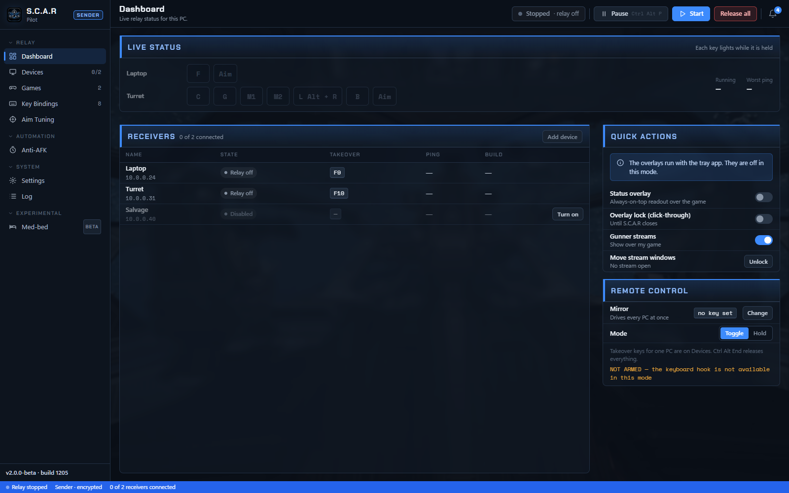
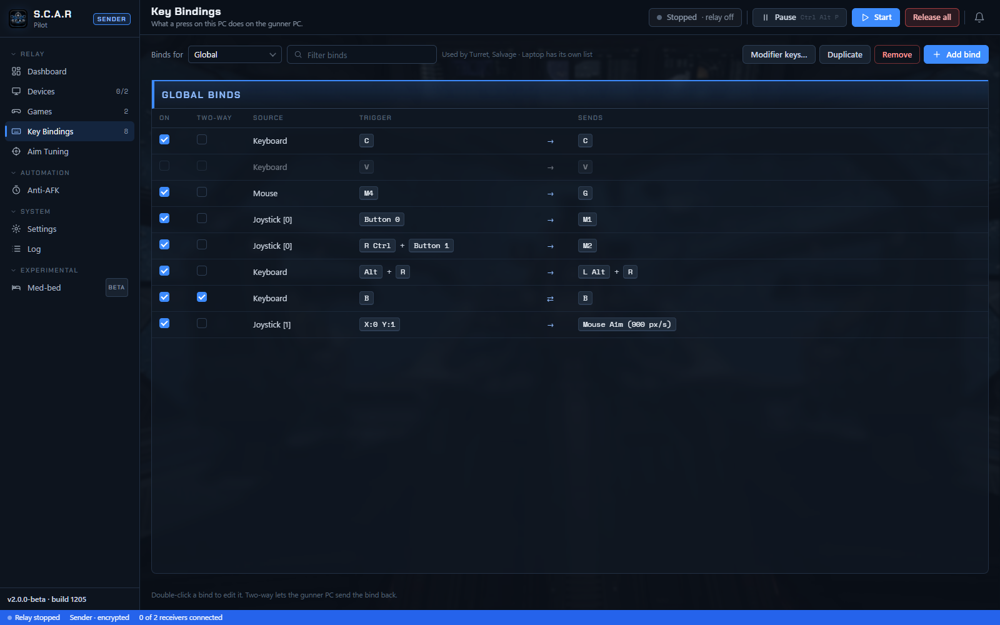
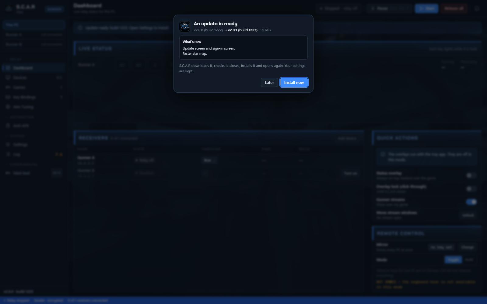

# S.C.A.R — SC Account Relay

**Fly one ship, crew it from multiple PCs.**
S.C.A.R lets one player control Star Citizen on several PCs at once. The sender PC sends key presses, mouse aim and
joystick input over your home network to the receiver PCs, so one person can run a whole crew to an extent.

[**⬇ Download the latest Setup**](https://github.com/Hunter13294/S.C.A.R/releases/latest)

---

## How it works

Install S.C.A.R on every PC. One PC is the **Sender**: the PC you play on. The others are **Receivers**: the PCs it
controls, for example a turret or a salvage PC. Press Start on each, and the Sender's binds are played on the
Receivers.

All traffic stays on your own network. It is encrypted, and a PC only accepts input from PCs that use the same
network key.

## What it does

- **Key Bindings** — map any key, mouse button, joystick button or hat on the sender PC to a key on a receiver PC.
  Combos (Alt + R), two-way binds, and a list per PC or one shared list.
- **Mouse aim** — relay a stick or the mouse as aim on a receiver PC, with a per-PC aim scale so receivers track the same.
- **Takeover** — press a PC's key and your keyboard and mouse drive that PC directly. Press it again to come back.
- **Mirror** — your keyboard and mouse drive every PC at once.
- **Stick mirror** — use your sticks on another PC through vJoy (optional).
- **Gunner Cam** — see the receiver PCs' screens (or parts of them) as small windows over your game.
- **Status overlay** — a small always-on-top readout over the game: who is connected, which keys are held.
- **Anti-AFK** — keeps a game from logging you out while you are busy on another PC.
- **Phone remote** — scan a QR code and control S.C.A.R from your phone.
- **One-click updates** — when a new version is out, S.C.A.R shows it at start. One click downloads, checks and
  installs it, and your settings are kept.
- **Safety** — `Ctrl + Alt + End` releases every key on every PC at once.

## Install

1. Download `SC_Account_Relay_Setup-<version>.exe` from the
   [latest release](https://github.com/Hunter13294/S.C.A.R/releases/latest).
2. Run it on every PC. Windows may show a SmartScreen warning because the installer is not signed:
   click **More info**, then **Run anyway**.
3. Open S.C.A.R, pick **Sender** on the PC you play on and **Receiver** on the others, and set the same network key on all
   of them (Settings > Connection).

S.C.A.R asks for administrator rights when it starts. Windows blocks input sent into programs that run as
administrator, so S.C.A.R needs the same rights to reach them.

**Needs:** Windows 10 or 11 on every PC, all PCs on the same home network. vJoy only for the stick mirror.

## Updates

S.C.A.R checks this page when it starts. When a newer version is here, it shows you what is new and installs it with
one click. You can also check by hand in Settings > Updates.

Each PC updates itself. The Dashboard warns you when two PCs run different builds.

---

*S.C.A.R is an unofficial fan-made tool. It is not made by, or affiliated with, Cloud Imperium Games.
Star Citizen® is a trademark of Cloud Imperium Rights LLC.*
